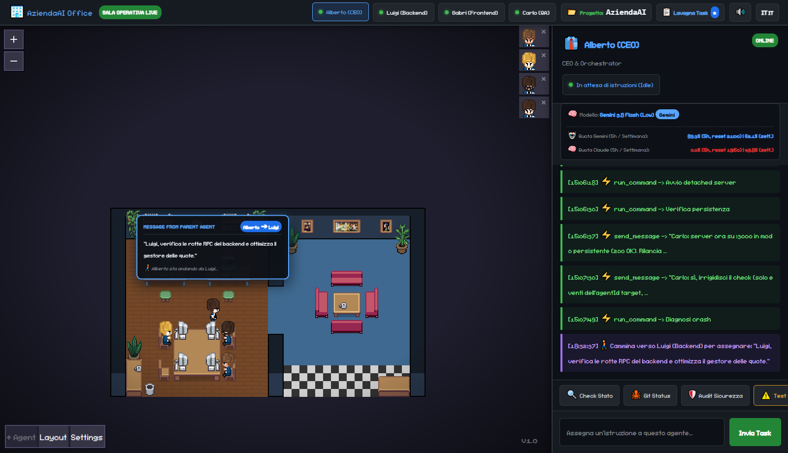

<div align="center">

# 🏢 AziendaAI Office — Sala Operativa Multi-Agente Autónoma

<p align="center">
  <strong>Oficina virtual en 2D Pixel-Art para Google Antigravity. Convierte subagentes de IA en un equipo de desarrollo autónomo sincronizado con el modelo de negocio de <code>C:\react-native</code> (Buskdos) mediante Graphify y Obsidian Vault.</strong>
</p>

<p align="center">
  🇪🇸 <strong>Español (Predeterminado)</strong> • <a href="./README.it.md">🇮🇹 <strong>Leggi in Italiano</strong></a>
</p>

[](https://nodejs.org/)
[](#)
[](#)
[](#)
[](https://obsidian.md/)
[](./LICENSE)

<br/>

### 🖥️ Sala Operativa en Vivo (`http://localhost:3000`)
*Barra superior con los 5 integrantes del equipo, espacio central de oficina 2D donde los agentes caminan físicamente para delegarse tareas, y panel lateral con telemetría de cuotas (Gemini y Claude), logs en tiempo real y tablero Kanban.*



</div>

---

## 🎯 Contexto del Negocio y Propósito

Esta sala operativa está configurada para gobernar, auditar y desarrollar el ecosistema de **Buskdos** (`C:\react-native`), un monorepositorio compuesto por 4 sistemas clave:

1. 📱 **`appbuskdos`**: Aplicación móvil principal en **React Native**.
2. ⚙️ **`node-backend-supabase-buskdos`**: Servidor Node.js, endpoints REST/WebSockets y base de datos **Supabase / PostgreSQL**.
3. 🖥️ **`buskdos-admin`**: Panel web administrativo y analítico.
4. 🌐 **`landing-page-buskdos`**: Página web comercial y de captación.

### 🧠 El Eje Central: Graphify + Bóveda de Obsidian (`graphify-out/`)
El equipo de agentes no trabaja a ciegas; consulta y respeta un grafo de conocimiento con **más de 6,000 nodos y 17,000 relaciones**, asegurando el estricto cumplimiento de:
- **`REGLAS_NEGOCIO_PRECIOS_BUSKDOS.txt`**: Tarifas comerciales, comisiones y planes *Free vs. Pro*.
- **`MATRIZ_PERMISOS_ROLES.md`**: Jerarquía de roles (`USER`, `ORG_OWNER`, `ORG_ADMIN`, `STORE_MANAGER`, `STORE_STAFF`).
- **`AUDITORIA_NOTIFICACIONES_Y_MENSAJES.md`**: Seguridad y políticas de comunicación en tiempo real.
- **Bóveda de Obsidian (`obsidian-vault/`)**: Documentación funcional en 5 secciones de producto (Propósito, Ubicación, Reglas de Negocio, Roles y Dependencias).

---

## 👥 Equipo Oficial de Agentes

Cada agente cuenta con su escritorio en la oficina física y un proceso autónomo en Antigravity con failover automático **Gemini ⇄ Claude**:

| Agente | Rol | Puesto / Asiento | Especialidad en Buskdos |
| :--- | :--- | :---: | :--- |
| 👔 **Alberto (CEO)** | **CEO & Orquestador** | `f-1773356768339-eo6u` | Planifica sprints, coordina al equipo y aprueba lanzamientos. |
| ⚙️ **Luigi (Backend)** | **Ingeniero Backend & BD** | `f-1773354881902-9m50` | Desarrolla APIs, WebSockets y modelos PostgreSQL en `node-backend-supabase-buskdos`. |
| 🎨 **Gabri (Frontend)** | **Arquitecto Frontend & Mobile**| `f-1773354879805-px9b` | Interfaz de `appbuskdos` (React Native), componentes UI y canvas. |
| 🛡️ **Carlo (QA)** | **Auditor de Seguridad y Código** | `f-1773354880309-yphd` | Modo estricto de solo lectura. Audita integridad, linters y seguridad. |
| 💎 **Bruno (Auditor Negocio)** | **Auditor de Negocio & Obsidian / Graphify** | `f-1773356769007-a8jm` | Audita que todo cambio cumpla el modelo de negocio y mantiene al día Obsidian y Graphify. |

---

## 🚀 Capacidades y Funcionalidades Clave

### 1. Delegación Física de Tareas en Pixel Art
Cuando **Alberto (CEO)** asigna una tarea a otro miembro, el avatar se levanta de su silla, camina hacia el escritorio del colega y le entrega la instrucción con un globo de diálogo flotante en vivo (`📋 DELEGACIÓN OPERATIVA CEO`).

### 2. Conmutación por Error Automática (Gemini ⇄ Claude)
Monitorea las cuotas de 5 horas y semanales del daemon de Antigravity cada 15 segundos. Si la cuota de **Gemini** desciende por debajo del `2%`, conmuta al alterego en **Claude** automáticamente sin detener la operación.

### 3. Modos de Convivencia y Descanso
- ☕ **Pausa Café / Sala Relax (`☕ Pausa Café`)**: Si el equipo entra en descanso o está inactivo, caminan a la sala de descanso y se sientan en los sofás. Regresan inmediatamente al recibir una tarea.
- 📢 **Reunión General (`📢 Convocar Reunión`)**: Reúne a todos los agentes alrededor del escritorio de Alberto para una sincronización de sprint.
- 📋 **Tablero Kanban en Tiempo Real**: Panel de 3 columnas (`⏳ En Cola`, `⚡ En Progreso`, `✅ Completadas`) para inspeccionar cada ticket de trabajo.
- 📂 **Multi-Workspace Selector**: Permite alternar con un clic entre la raíz `C:\react-native`, `appbuskdos`, `node-backend-supabase-buskdos` o `buskdos-admin`.

---

## 🛠️ Instalación y Puesta en Marcha

### Prerrequisitos
- Node.js 18+ instalado.
- Google Antigravity abierto en el sistema.

### Iniciar la Oficina
```powershell
# 1. Clonar el repositorio
git clone https://github.com/nestorpedraza/pixel-agents-antigravity.git
cd pixel-agents-antigravity

# 2. Instalar dependencias
npm install

# 3. Arrancar el servidor
npm start
```

Abre tu navegador en:  
👉 **[http://localhost:3000](http://localhost:3000)**

---

## 📜 Licencia

Distribuido bajo la Licencia **MIT**. Consulta [`LICENSE`](./LICENSE) para más detalles.
